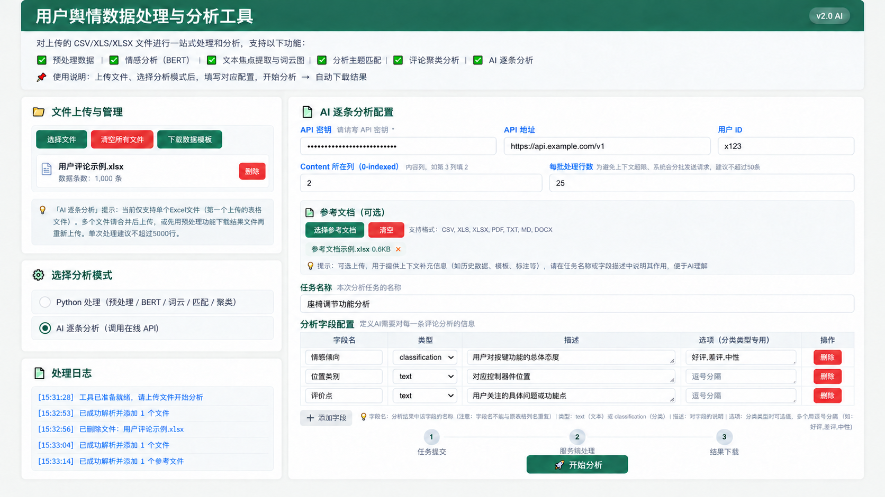

# AI批量文本分析工具

**配置任务与输出字段，将表格中的用户反馈批量转换为可复核的分析结果。**

Python / Flask · HTML / JavaScript · LLM API集成 · SSE · JSON / Excel · Python NLP

作者：[TreeeggZ](https://github.com/TreeeggZ) · 项目展示 · 更新：2026-10-23

本仓库展示功能、实现思路与个人贡献，暂不提供源码。

## 界面示意

**下图为AI生成的横版界面示意，非实际运行截图。**用于说明上传、配置与结果处理的布局，图中的版本号、数据和日志均为示例。

## 项目背景

最初的文本打标通过模型对话窗口提交数据，但受当时工具的上下文与单次处理量限制，难以一次完成大批量标注。因此，将任务描述、分类选项和输出字段配置化，由Python分批调用模型，并将结果整理回Excel。

项目先在个人电脑上运行，随后为方便他人直接使用，迭代为Flask Web应用并部署到平台环境，通过浏览器完成文件上传、任务配置、模型调用和结果导出。

## 核心功能

| 功能 | 实现内容 |
| --- | --- |
| 分析任务配置 | 设置任务描述、输出字段和分类选项，动态组织提示词 |
| AI批量处理 | 通过AI应用平台API调用模型能力，按批处理表格文本 |
| 结构化结果 | 聚合SSE响应、解析JSON，将分析字段回填Excel |
| 异常与导出 | 对格式异常、接口超时设置有限重试和错误标记，保存备份并打包导出 |
| Python NLP分析 | 集成jieba/TF-IDF关键词提取、DistilBERT情感分类及BERTopic主题聚类 |

输入是已经整理或导出的表格。模型能力通过类似Dify的AI应用平台API接入，批处理编排与结果整理由Python完成。

## 技术流程

响应通过SSE接收；处理过程中加入有限重试、错误标记与结果备份，导出时打包为ZIP。

Python NLP是另一种处理路径，按所选功能执行关键词、情感和主题分析。它与AI批量标注目前分别使用，尚未串联为“聚类后交由LLM分析”的自动流程。更多细节见[实现说明](docs/implementation.md)。

## 个人职责与应用情况

主导需求梳理、流程设计、开发迭代和交付，使用AI辅助编码，重点实现任务字段配置、分批请求、响应解析与结果导出。Web化过程中有同事参与框架搭建。

按实际工作量估算，典型分析任务从约3天缩短到约1天，累计处理百余次任务。以上指完整分析任务的周期与数量，不是单次API耗时或分批请求次数。

项目重点是把变化的分析需求变成可配置输入，并把模型回答转换为可复核的表格结果。

## 展示材料

- 界面示意与技术流程。
- [实现说明](docs/implementation.md)：Web化、任务配置、API集成与Python NLP。
- [虚构演示输入](examples/README.md)：用于说明输入形式。

当前仓库用于项目介绍，没有公开运行入口。配图与示例数据的说明见[展示范围](docs/scope.md)。
